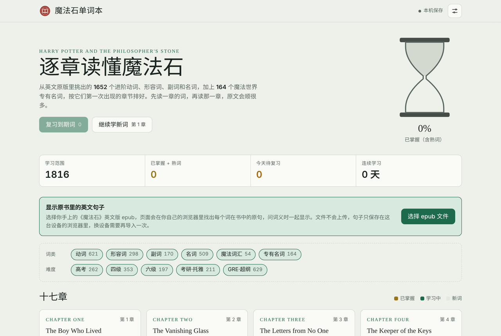
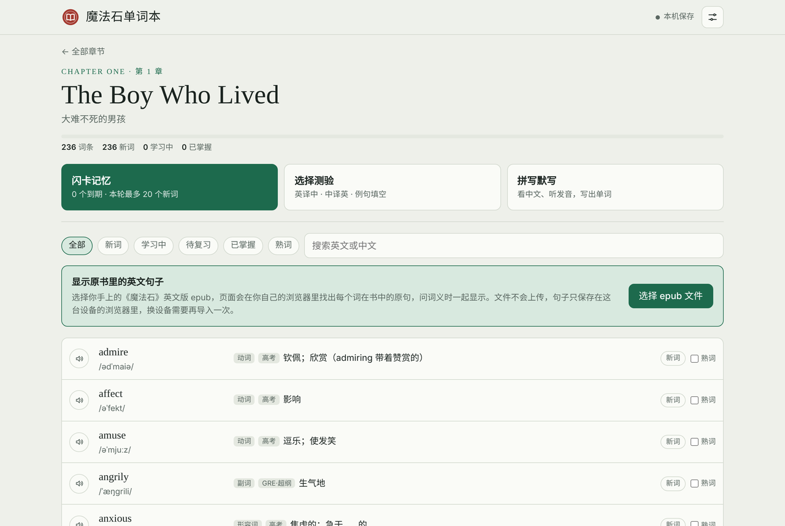
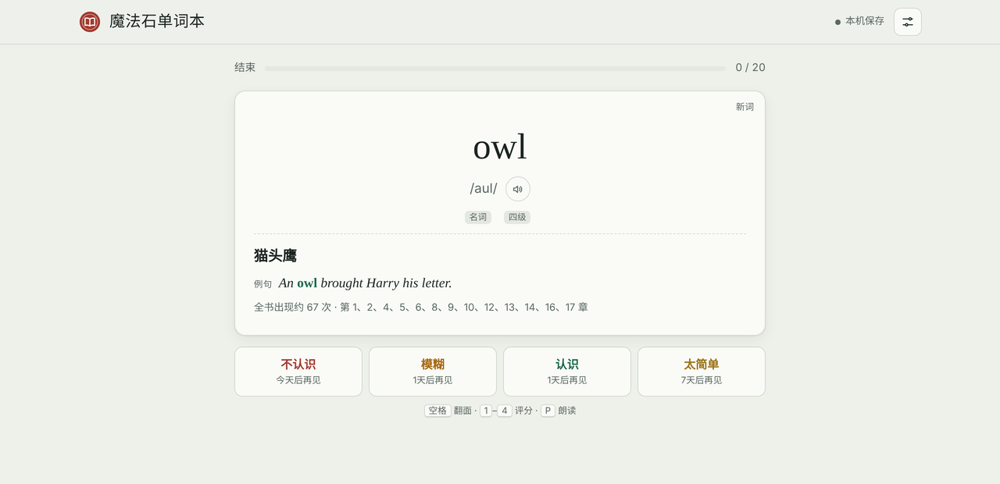
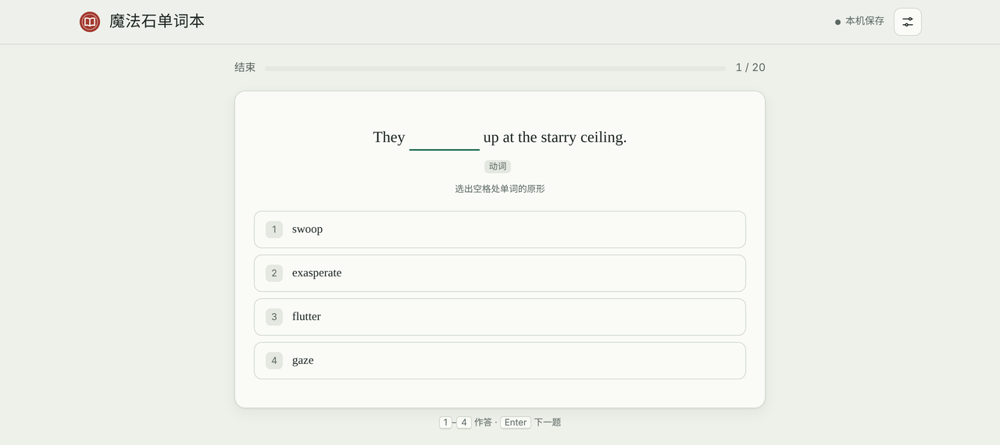
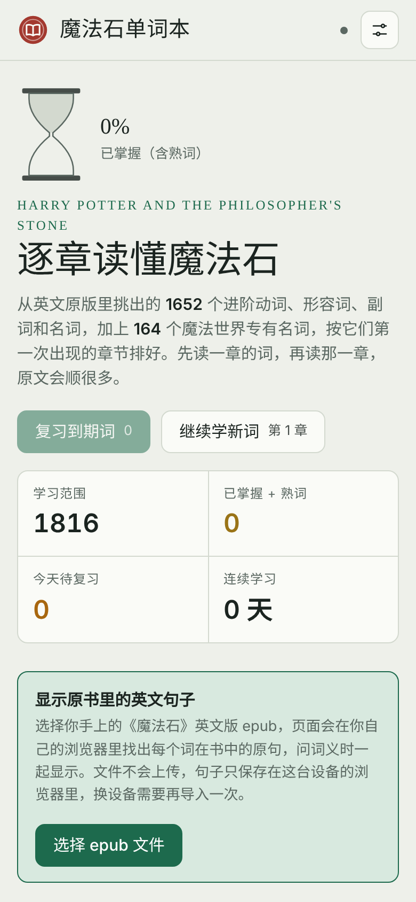
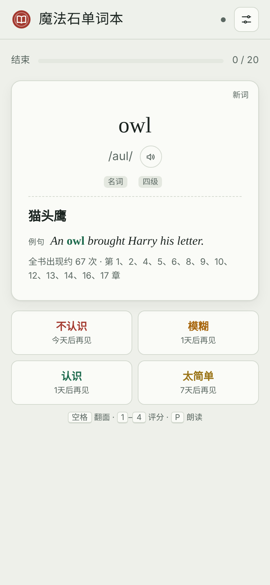

# 魔法石单词本 · HP Vocab Trainer

按《哈利·波特与魔法石》英文原版的章节，一章一章背单词、读原著。

**在线使用：** https://leij678-warmglass.github.io/hp-vocab-trainer/

## 为什么做这个

- 《哈利·波特》故事有趣，词汇量适中，很适合用来读第一本英文原著。
- 中文译本很难保留 J.K. 罗琳的英式冷幽默，读原文更有味道。
- 先背这一章的生词，再读这一章，读原著时就不用一直停下来查词典。

## 功能

| | |
|---|---|
| **词库** | 1,652 个进阶词（动词 621、名词 509、形容词 298、副词 170、魔法词汇 54）加上 164 个魔法世界专有名词（人物、地点、咒语、魁地奇……），共 1,816 条，按第一次出现的章节分到 17 章 |
| **每个词** | 英式音标、中文释义、原创例句、难度分级（高考 / 四级 / 六级 / 考研·托雅 / GRE·超纲）、全书出现次数和章节 |
| **闪卡记忆** | 间隔重复（Leitner 记忆盒）：不认识 / 模糊 / 认识 / 太简单，按掌握程度安排复习时间 |
| **选择测验** | 英译中、中译英、例句填空，干扰项优先选同一章、同词性的词 |
| **拼写默写** | 看中文、听发音，写出单词 |
| **原书例句** | 导入你自己的英文版 epub，页面在浏览器里本地解析，问词义时同时显示这个词在书中的原句（文件不会上传） |
| **其他** | 进度保存在浏览器本地；按词类和难度筛选；熟词标记；英音 / 美音朗读；深色模式；手机适配；键盘快捷键 |

  
  

  
  

  
  

## 怎么用

1. 打开上面的在线地址（也可以下载 `index.html`，直接用浏览器打开）。
2. 选一章，先浏览词表，再用闪卡记忆，最后用测验和拼写巩固。
3. 学完这一章的词，再去读这一章的原文。
4. 可选：在首页点「选择 epub 文件」，导入你自己的英文版电子书，就能看到每个词在书中的原句。

快捷键：闪卡里 `空格` 翻面、`1`–`4` 评分、`P` 朗读；测验里 `1`–`4` 作答、`Enter` 下一题。

## 怎么做出来的

- **选词：** 用 spaCy 给原书做词形还原和词性标注，再结合 wordfreq 词频和 ECDICT 的考试标签，去掉最基础的词，只留下动词、形容词、副词、不常见名词和魔法世界专有名词。
- **整理：** 逐条整理中文释义和音标，例句全部重新原创，专有名词的注释只写到它第一次出现时读者知道的内容，不剧透。
- **前端：** 单个 HTML 文件，原生 JavaScript，没有构建步骤；用 JSZip 在浏览器里解析 epub。
- **开发方式：** 我负责选题、需求设计和测试反馈，代码实现和数据整理借助 AI 编程助手 Claude 完成。

## 计划

- 扩展到系列第 2–7 部。

## 版权说明

- 本仓库不包含原书的任何文本。例句都是原创的；「原书例句」功能只在你自己的浏览器里读取你自己的 epub 文件。
- 这是一个个人学习用的非官方粉丝项目，与 J.K. Rowling、Bloomsbury、Warner Bros. 没有任何关系。Harry Potter 及相关名称是其各自所有者的商标。

---

## English summary

A chapter-by-chapter vocabulary trainer for reading *Harry Potter and the Philosopher's Stone* in English, made for Chinese-speaking learners.

- 1,816 entries: 1,652 intermediate-to-advanced words plus 164 wizarding-world proper nouns, grouped by the chapter where each first appears.
- IPA, Chinese meanings, original example sentences, exam-level tags, and how often each word appears in the book.
- Spaced-repetition flashcards, multiple-choice quizzes (EN→ZH, ZH→EN, cloze) and spelling practice.
- Optional: load your own EPUB copy to see each word's original sentence. Parsing happens entirely in the browser; nothing is uploaded.
- One self-contained HTML file with vanilla JavaScript. Progress is stored in the browser.

This is an unofficial fan project for personal study. It contains no text from the book and is not affiliated with J.K. Rowling, Bloomsbury or Warner Bros.
